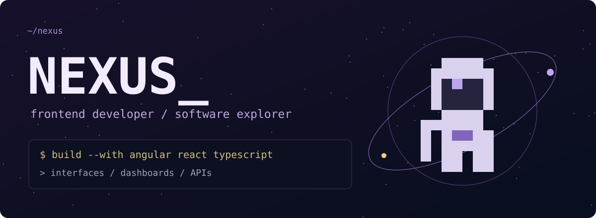
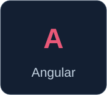
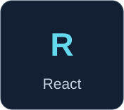
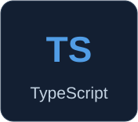
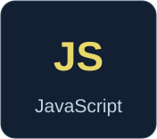
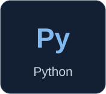
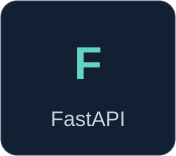
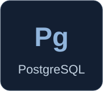
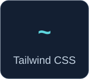

<h1 align="center">Nexus here. Said Ahmed behind the code.</h1>

<strong>Frontend Developer · Angular / React / TypeScript</strong>

## Behind the handle

I turn designs into web interfaces. My work includes e-commerce screens, dashboards, state management and API integration.

My development loop: build it, try different user paths, find what breaks, and test the fix.

Frontend is my focus. Python and FastAPI let me work on the API side too.

## Tools on board

## Project log

### 01 / [Nexus Store · Frontend](https://github.com/SaidNexus/Nexus-Store-Frontend)
`React` `JavaScript` `Tailwind CSS` `Material UI`

Storefront with product browsing, cart and checkout screens, account pages and an admin area. Includes API-connected cart state and guest-cart storage.

### 02 / [Bundle Builder](https://github.com/SaidNexus/ecomexperts-bundle-builder)
`React` `TypeScript` `Tailwind CSS`

Interface for configuring a security-system bundle, reviewing selections and calculating a price summary.

### 03 / [Dashboard UI](https://github.com/SaidNexus/dashboard-UI-)
`React` `JavaScript` `Recharts`

Dashboard interface with charts and separate views for users, inventory, transactions and reports.

### 04 / [Nexus Store · Backend](https://github.com/SaidNexus/Nexus-Store-Backend)
`Python` `FastAPI` `PostgreSQL`

API code with routes for authentication, products, categories, cart, orders and reviews.

---

<strong>From the first screen to the API.</strong>

Interested in frontend and software development opportunities.

